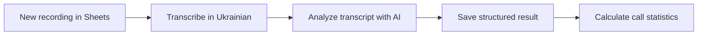

# AI Call Analysis

**Status:** Demonstration project  
**Use case:** Turn recorded customer calls into searchable, structured information.

## Overview

The workflow processes recording links from a Google Sheets queue. It waits for the transcription service to finish, analyzes the Ukrainian transcript, and saves the result for later reporting.

## Workflow

## Main steps

1. Read queued recording URLs from Google Sheets.
2. Submit each recording to AssemblyAI for Ukrainian transcription.
3. Wait for transcription completion before requesting the transcript.
4. Use an AI model to classify sentiment and assign a topic such as cake, delivery, or other.
5. Store transcript fields, processing status, duration, and classification in the results table.
6. Aggregate totals and negative-call counts for requested time periods.

## Reliability decisions

- Track processing status and timestamps to avoid unintentionally processing the same row again.
- Wait for the transcription job to complete before analyzing its output.
- Limit parallel processing to control request volume and make failures easier to trace.

## Tools

- n8n
- Google Sheets
- AssemblyAI
- OpenAI API
- HTTP APIs and structured JSON

## What this demonstrates

- Asynchronous API processing
- Queue-based workflow design
- AI classification of unstructured text
- Data normalization for later reporting
- Handling service latency and duplicate processing

## Scope

This is a portfolio demonstration. It does not include real customer recordings or claim measured business outcomes. A production setup would need consent and retention policies for recordings, secure credential management, and monitoring for failed transcription jobs.
