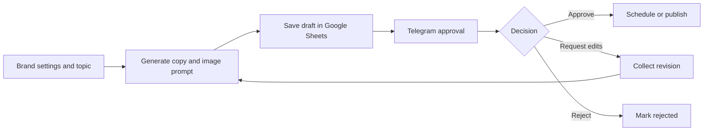

# AI Content Studio

**Status:** Demonstration project  
**Use case:** Prepare, review, and schedule social media content for a bakery scenario.

## Overview

This n8n workflow turns brand settings and a selected topic into a Ukrainian social media draft. The draft is stored in Google Sheets, and an editor reviews it in Telegram before it can be scheduled for publishing.

## Workflow

## Main steps

1. Read brand voice, audience, language, and content limits from Google Sheets.
2. Generate a caption and image prompt with the OpenAI API.
3. Save the draft, image reference, status, and schedule fields to the content sheet.
4. Send a preview to Telegram with approve, request-edits, and reject buttons.
5. Process Telegram callback actions and record the decision.
6. For requested edits, collect feedback, update the draft, and send it for review again.
7. Schedule approved content using the configured Kyiv time zone and publish it to a Telegram channel.

## Tools

- n8n
- OpenAI API
- Google Sheets and Google Drive
- Telegram Bot API
- Webhooks and callback queries

## What this demonstrates

- A human approval step before publication
- Revision and rejection branches
- Structured tracking of drafts and publication status
- Scheduling with an explicit time zone
- Separation of brand rules from workflow logic

## Scope

This is a portfolio demonstration using a bakery scenario. The documented publishing path is Telegram; direct Instagram publishing is not included. Production use would require the business's own account credentials, channel permissions, and operational monitoring.
