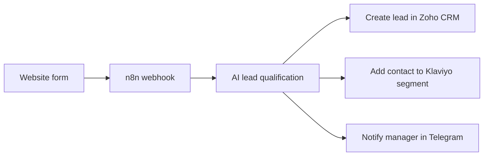
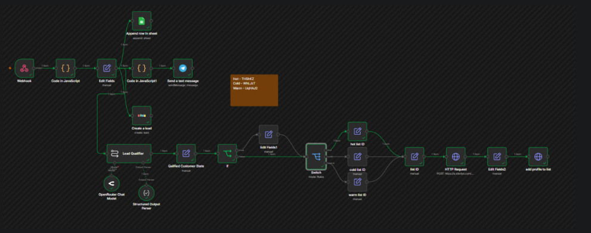

# AI Lead Qualification & CRM Automation

**Status:** Demonstration project  
**Scenario:** Smart Home service receiving quote requests from its website.

## Overview

This n8n workflow receives a website inquiry through a webhook, uses AI to classify the lead's interest level, and routes the lead information to the team's CRM and marketing tools.

## Workflow

## Workflow screenshot

## Main steps

1. Accept the submitted form fields and customer comment through a webhook.
2. Ask OpenAI to classify the lead as **Hot**, **Warm**, or **Cold** based on the comment.
3. Create a lead in Zoho CRM with the submitted information and AI classification.
4. Add the contact to the corresponding Klaviyo list or segment.
5. Send the manager a Telegram notification with the key lead details and priority.

## Results in the demonstration

- Each test submission follows the automated qualification and routing path.
- Data transfer to Zoho CRM and Klaviyo requires no manual copying after form submission.
- The workflow sends the classification and new-lead notification to Telegram.

These results describe the configured demonstration workflow; they are not measured client-business outcomes.

## Tools

- n8n
- OpenAI API
- Zoho CRM
- Klaviyo
- Telegram Bot API
- Webhooks and REST APIs

## What this demonstrates

- Connecting an external web form to a multi-service workflow
- Applying AI classification to free-form customer comments
- Routing one request to CRM, marketing automation, and a human notification channel
- Passing structured data between APIs

## Scope

Smart Home is a portfolio scenario. Production use would require the business's own form, CRM, and marketing credentials, plus validation of classification rules and consent requirements for contact data.
