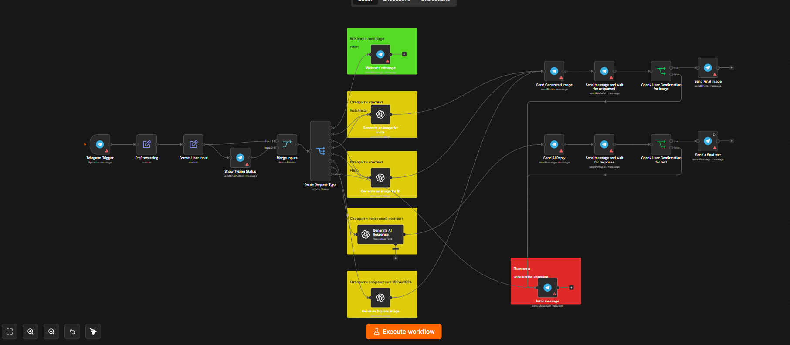

# AI Telegram Assistant

**Status:** Demonstration project  
**Use case:** Telegram assistant for AI text responses and image generation.

## Overview

This n8n workflow receives a Telegram message, normalizes the request, and routes it to an AI text or image generation path. It returns the generated result in Telegram and includes handling for user confirmation and workflow errors.

## Workflow screenshot

The screenshot shows the workflow canvas. Warning markers indicate environment-specific credentials or configuration that must be set for a runnable deployment; no credentials are included in the repository.

## Main steps

1. Receive a Telegram update and normalize the message.
2. Route text requests and image-generation requests to the corresponding AI node.
3. Send the generated response or image to the Telegram chat.
4. For image requests, wait for confirmation before sending the final image.
5. Send an error message when the workflow reaches its error branch.

## Tools

- n8n
- Telegram Bot API
- OpenAI API
- Webhooks and request routing

## What this demonstrates

- A Telegram-based interface for AI features
- Branching between text and image requests
- User confirmation before delivery of generated images
- An explicit workflow error path

## Scope

This is a portfolio demonstration. The screenshot documents workflow structure and does not guarantee the configuration is ready to run in another n8n workspace. Production use requires the operator's own API credentials and Telegram bot configuration.
