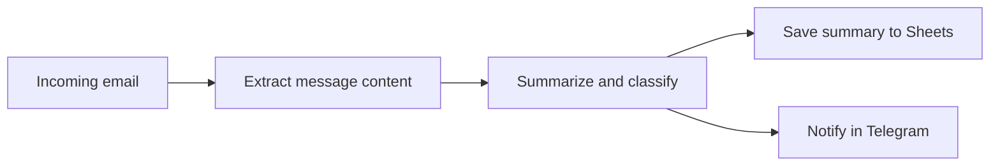

# Gmail AI Assistant

**Status:** Prototype  
**Use case:** Convert incoming email into a short, actionable summary.

## Overview

The workflow reads incoming email, asks an AI model to extract the key information, and records the result in Google Sheets. A Telegram notification makes the summary easier to review.

## Workflow

## Main steps

1. Read a new email from Gmail.
2. Prepare the message content for analysis.
3. Ask an AI model for a concise summary, priority, and recommended next step.
4. Store the extracted fields in Google Sheets.
5. Send a Telegram notification with the result.

## Tools

- n8n
- Gmail
- OpenAI API
- Google Sheets
- Telegram Bot API

## What this demonstrates

- Connecting an email trigger to an AI processing step
- Extracting consistent fields from free-form messages
- Routing results to a spreadsheet and notification channel
- Thinking through thread handling and duplicate notifications

## Scope

This prototype is intended for review and learning. Email threading and duplicate-message handling need to be validated against the target mailbox before production use. The repository contains no email content or credentials.
